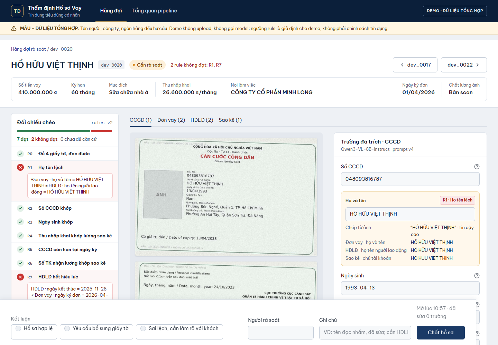
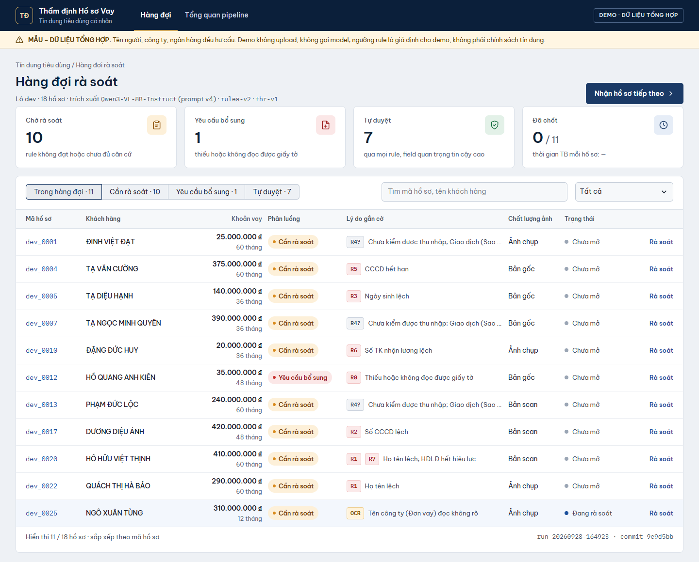
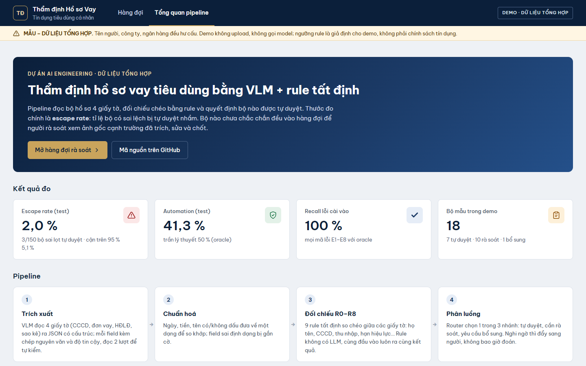
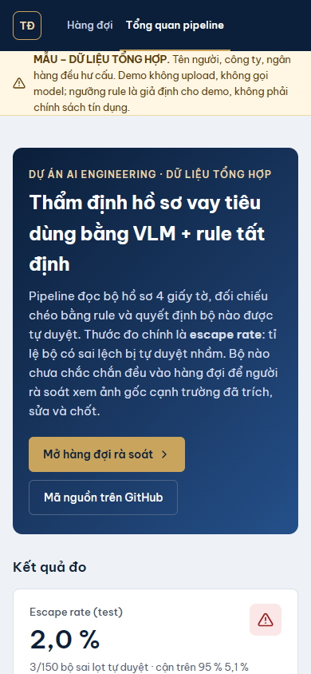

# Loan Document Pipeline

**Demo:** https://loan-doc-pipeline.onrender.com (Render, Docker; trang [Tổng quan pipeline](https://loan-doc-pipeline.onrender.com/?page=overview) tóm tắt kết quả đo). Gói free ngủ khi lâu không ai vào: lần mở đầu chờ khoảng 1 phút. Dữ liệu tổng hợp, không upload, không gọi model.

MVP tự động hóa khâu tiếp nhận hồ sơ vay tiêu dùng cá nhân: **trích xuất** thông tin từ 4 loại giấy tờ → **đối chiếu chéo** bằng rule tất định → **route** mỗi bộ vào 1 trong 3 nhánh (auto-pass / người rà soát / yêu cầu bổ sung).

Câu hỏi dự án phải trả lời: *ở cấu hình nào pipeline tự xử lý được nhiều bộ nhất mà không để lọt bộ nào có sai lệch?* Thước đo chính là **escape rate** (bộ có sai lệch bị auto-pass), báo cáo kèm cận trên 95%; automation rate là kết quả đầu ra, không đặt trước.

> **Toàn bộ dữ liệu là synthetic.** Tên người, công ty, ngân hàng đều hư cấu; mọi trang in dòng "MẪU – DỮ LIỆU TỔNG HỢP". Không dùng dữ liệu khách hàng thật dưới bất kỳ hình thức nào, kể cả đã ẩn danh (Nghị định 13/2023 về bảo vệ dữ liệu cá nhân). Các ngưỡng rule là **giả định cho demo**, không phải chính sách tín dụng của ngân hàng nào.

Spec đầy đủ: [`docs/spec.md`](docs/spec.md). Cách sinh dữ liệu và giới hạn: [`docs/data_card.md`](docs/data_card.md).

## Ảnh chụp demo

Chụp từ bản chạy thật trên Render (13/11/2026).

**Rà soát một hồ sơ**: ảnh gốc cạnh trường đã trích; rule không đạt (R1 họ tên lệch, R7 HĐLĐ hết hiệu lực) hiện bằng chứng, trường bị gắn cờ tô vàng kèm giá trị ở các giấy tờ khác để đối chiếu; thanh kết luận ở đáy.



**Hàng đợi rà soát**: KPI theo nhánh, lọc theo phân luồng / chất lượng ảnh, lý do gắn cờ theo mã rule.



<details><summary><b>Tổng quan pipeline</b> (kết quả đo, các bước, rule R0–R8, so sánh biến thể) và <b>giao diện mobile</b></summary>





</details>

## Trạng thái

| Giai đoạn | Nội dung | Trạng thái |
|---|---|---|
| M0 | Xác minh bài toán với 2–3 cán bộ tín dụng (A1, A2) | ⏳ bộ câu hỏi sẵn: [`docs/m0_interview.md`](docs/m0_interview.md) |
| M1 | Bộ sinh dữ liệu: 3 layout/loại (C held-out), lỗi E1–E8, near-miss, 3 mức augmentation, manifest | ✅ |
| M2 | Spike trích xuất VLM, gate: field quan trọng ≥ 90% trên dev clean | ✅ gate đạt; chọn Qwen3-VL-8B (dev clean: automation 53,8% = trần, escape 0); quy trình và benchmark: [`docs/m2_eval.md`](docs/m2_eval.md) |
| M3 | Rule R0–R8, router, trace JSON, `make eval` | ✅ phần tất định, đã kiểm bằng oracle |
| M4 | Review UI Streamlit, chạy test đóng băng 1 lần, demo | ✅ UI rà soát (`app.py`); ✅ test chạy 1 lần: escape 3/150 = 2,0% (cận trên 5,1%), automation 41,3%; ✅ [demo Render](https://loan-doc-pipeline.onrender.com) |

M3 làm trước M2 có chủ đích: eval harness cần có sẵn để chấm M2, và chạy rule trên ground truth là cách duy nhất kiểm chứng nhãn của bộ sinh dữ liệu là đúng.

### Kết quả hiện tại: oracle (cận trên)

Extractor `oracle` trả đúng chuỗi đã in lên ảnh, không gọi model. Nó đo phần tất định: chuẩn hóa, rule, router. Mọi con số dưới 100% ở đây là bug của code, không phải của model.

| Split | Bộ (có lỗi) | Escape | Cận trên 95% | Automation | False review | Field acc |
|---|---|---|---|---|---|---|
| dev | 50 (25) | 0% | 11,3% | 50% | 0% | 100% |
| test | 300 (150) | 0% | 2,0% | 50% | 0% | 100% |

Recall mọi mã lỗi E1–E8 = 100%, không near-miss nào bị gắn cờ. Kết quả với VLM thật (Qwen3-VL-8B), **test set chạy 1 lần**: escape 3/150 = 2,0% (cận trên 5,1%), automation 41,3% (trần 50%). Cả 3 bộ lọt là E1: model "sửa" tên trên đơn cho giống tên quen (Thăng → Thắng), đúng rủi ro spec đã nêu; phân tích ở [`docs/m2_eval.md`](docs/m2_eval.md).

## Chạy

```bash
pip install -r requirements.txt
pytest -q                                            # 127 tests (last verified 13/11)

python -m datagen.build --seed 42                    # dev 50 + test 300 kèm ảnh -> data/synthetic/  (vài phút)
python -m loanpipe.evaluate --split dev --extractor oracle
#   -> reports/<run_id>/report.md, metrics.json, errors.csv, traces/*.json; reports/runs.csv
python -m loanpipe.compare --split dev
#   -> reports/comparison.md, comparison.csv: gộp biến thể, paired diff route so với baseline

# Nhanh, không vẽ ảnh (CI dùng cách này):
python -m datagen.build --seed 42 --no-images --out data/synthetic-fast
python -m loanpipe.evaluate --split dev --data data/synthetic-fast --no-file-check
```

Có `make` thì dùng: `make test`, `make data SEED=42`, `make eval SPLIT=dev`, `make compare SPLIT=dev`, `make check`.

### Quality Engineering

Dự án có bộ hồ sơ QE thực hành gồm risk-based test strategy, functional/integration/regression test cases,
kịch bản UI, truy vấn SQL kiểm tra hàng đợi review và một defect đã được tái hiện, sửa và thêm regression test:
[`docs/quality-engineering.md`](docs/quality-engineering.md).

Automation hiện dùng pytest và Streamlit AppTest; CI chạy suite này trên pull request/push. Ứng dụng chưa có
REST API nên không tuyên bố có API/Postman coverage. Dữ liệu kiểm thử đều synthetic.

### Demo: giao diện rà soát

```bash
streamlit run app.py
```

Hàng đợi REVIEW / REQUEST_MORE, ảnh gốc cạnh field đã trích, field bị gắn cờ tô sáng kèm lý do; người rà soát sửa field rồi chốt 1 trong 3 kết luận (lưu SQLite `data/review.sqlite`, đổi bằng `$REVIEW_DB`, có thời gian xử lý). Demo chạy trên 18 bộ dev trong `data/synthetic/samples/` với kết quả Qwen3-VL-8B đã chạy sẵn: **không gọi model, không có upload** (spec mục 10), nên deploy không cần GPU. Tạo lại bộ mẫu từ một run dev: `python -m loanpipe.review build --run reports/<run_id>`.

Docker (image có font tiếng Việt nên chạy được cả test suite; kết quả rà soát ghi vào volume):

```bash
docker build -t loan-doc-pipeline .
docker run -p 8501:8501 -v loan-review:/data -e DEMO_PASSWORD=<mật khẩu> loan-doc-pipeline
docker run --rm loan-doc-pipeline python -m pytest -q    # 124 test
```

`DEMO_PASSWORD` để trống thì demo mở công khai (như demo trên Render); đặt giá trị thì phải nhập mật khẩu trước khi thấy hàng đợi.

Deploy (Streamlit Community Cloud, Render, Railway): cài `requirements.txt`, lệnh chạy `streamlit run app.py --server.port $PORT --server.address 0.0.0.0`. SQLite nằm trên đĩa tạm của nền tảng, mất khi redeploy: đủ cho demo.

**Test set đóng băng:** sinh một lần ở M1 và `datagen.build` từ chối ghi đè `test/manifest.jsonl` (trừ khi `--force`). Chỉ chạy eval trên test một lần cho mỗi phiên bản cuối; mọi việc chỉnh prompt, ngưỡng đều làm trên dev.

## Kiến trúc

Hai chế độ, chấm bằng cùng một harness:

- **Workflow** (mặc định): 6 bước cố định bên dưới.
- **Agent** (`--agent`, `loanpipe/agent.py`): LLM tự lập kế hoạch qua 4 tool `list_documents`, `read_document(doc_type, method)`, `run_rules`, `finish(route, note)`. Nó tự quyết đọc giấy tờ nào, theo thứ tự nào, đọc lại bằng `deskew`/`hires` khi field mờ, và dừng sớm (thiếu giấy tờ thì REQUEST_MORE mà không gọi VLM; cặp CCCD/đơn đã lệch thì REVIEW mà không đọc sao kê). Vòng ReAct + function calling chuẩn OpenAI, `max_turns`, output guardrail trả lỗi về cho model tự sửa (mẫu của OpenAI Agents SDK / Pydantic AI), viết bằng stdlib.

```
agent:  LLM ──► list_documents ──► read_document × n (VLM, từng giấy tờ) ──► run_rules ──► finish
         ▲                                                                                  │
         └───────────────── kết quả tool / lý do bị guardrail từ chối ◄─────────────────────┘
```

```
ingest ─► tiền xử lý ─► trích xuất (VLM, từng giấy tờ) ─► validate + chuẩn hóa + confidence ─► rule R0–R8 ─► router
 (R0: file đọc được?)                                     (Pydantic, code thuần)                (pass/fail/unknown)  AUTO_PASS | REVIEW | REQUEST_MORE
```

| Quyết định | Lý do |
|---|---|
| Agent điều phối, code giữ hàng rào | LLM quyết *làm gì tiếp*; *giá trị* và *quyết định an toàn* vẫn do code. Agent không đưa ra giá trị field (chỉ VLM, từng giấy tờ); đọc lại chỉ lấp chỗ trống, không phân xử bất đồng giữa các lượt đọc (lỗ E1); mỗi (giấy tờ, cách đọc) 1 lần; `finish(AUTO_PASS)` bị từ chối nếu router tất định trên dữ liệu hiện có không ra AUTO_PASS (giấy tờ chưa đọc = unknown); R0 fail chỉ được REQUEST_MORE; LLM lỗi / hết lượt thì dùng router. `tests/test_agent.py` chứng minh: policy đọc đủ cho đúng nhánh của workflow trên mọi bộ. |
| Trích xuất **từng giấy tờ riêng** | Đưa nhiều giấy tờ vào một prompt, model có thể "sửa" tên trên đơn cho khớp CCCD và che mất sai lệch thật. `tests/test_pipeline.py` giả lập đúng failure mode này và chứng minh eval bắt được. |
| Confidence **nhị phân** từ tín hiệu kiểm chứng được | VLM không trả xác suất đã hiệu chỉnh. `high` khi: định dạng hợp lệ + trả lời rõ ràng + 2 lần trích cho cùng kết quả. Không dùng việc khớp giữa các giấy tờ làm tín hiệu (rule đã kiểm, dùng lại là vòng tròn). |
| `unknown` không bao giờ là `pass` | Thiếu field hoặc confidence thấp → REVIEW. Chỉ bộ qua hết mọi kiểm tra mới AUTO_PASS. |
| Model chỉ chép, code tính | Lương trung bình, chuẩn hóa ngày/tiền/tên đều bằng code có unit test. Luôn giữ `raw` để truy vết. |
| Loại giấy tờ do người upload gắn | Thông tin có sẵn và đúng 100%; classifier để hạng "nên có". |

### Lệch so với spec (có chủ đích)

| Điểm | Spec | Repo | Lý do |
|---|---|---|---|
| Render | HTML + Jinja2 → WeasyPrint/Playwright | PIL | Không cần dependency hệ thống, chạy trên Windows. Nâng cấp nếu extractor đạt ~100% (test quá dễ). |
| Profile | Faker vi_VN | Danh sách tự soạn | Faker vi_VN sinh tên/địa chỉ kém tự nhiên; bớt một dependency. |
| Định dạng ảnh | PNG | JPEG (q95/q60/q75 theo mức) | PNG của ảnh nhiễu ~5–10 lần nặng hơn; JPEG chất lượng thấp vốn là một phần của augmentation. |

## Cấu trúc

```
loanpipe/
  schemas.py      # 4 schema giấy tờ + Field/Extraction/CheckResult/Decision + mã E1–E8, N1–N6
  normalize.py    # chuẩn hóa tên (giữ dấu, so khớp hybrid), ngày, tiền, CCCD, số TK
  validate.py     # raw -> value + confidence nhị phân
  rules.py        # R0–R8, hàm thuần
  router.py       # 3 nhánh, theo thứ tự spec mục 8
  pipeline.py     # workflow 6 bước + trace JSON
  evaluate.py     # eval 3 tầng, report.md / metrics.json / errors.csv, so với run trước
  compare.py      # bảng so sánh biến thể (gộp run, paired diff route), reports/comparison.md
  extract/        # Extractor: oracle (cận trên), ocr (EasyOCR + anchor), vlm (API tương thích OpenAI)
config/
  rules.yaml      # tolerance, regex giao dịch lương      (rules_version)
  thresholds.yaml # field quan trọng, tự nhất quán       (thresholds_version)
datagen/
  truth.py        # profile -> bộ hồ sơ, cài lỗi và near-miss
  render.py       # 3 layout/loại, ghi lại chuỗi raw đã in
  augment.py      # clean / scan / photo
  build.py        # CLI, chia dev/test, manifest.jsonl, đóng băng test
scripts/check_data_paths.py   # CI chặn ảnh/PDF ngoài data/synthetic/
docs/spec.md, docs/data_card.md
```

## B1: baseline OCR truyền thống

Extractor `ocr` là cực "không LLM" của trục so sánh: EasyOCR (vi+en, CPU) + neo theo mẫu giấy tờ + parser bảng sao kê dùng toạ độ cột. Không có model sinh, không gọi API. Kết quả là dòng **B1** trong [`docs/COMPARISON.md`](docs/COMPARISON.md) (bản chụp của `reports/comparison.md`), đặt cạnh B0 oracle và B3 VLM.

| Dev 50 bộ | Escape (cận trên 95 %) | Automation | False review | Field acc |
|---|---|---|---|---|
| B1 EasyOCR + anchor | 0/25 (11,3 %) | 8 % | 84 % | 72,3 % |
| B3 Qwen3-VL-8B | 0/25 (11,3 %) | 44 % | 12 % | 99,4 % |

Cả hai không để lọt bộ sai nào, vì router đẩy mọi thứ chưa chắc sang người rà soát. Cái giá của OCR nằm ở automation: 18 bộ VLM tự duyệt đúng thì OCR đẩy sang REVIEW, chủ yếu do sao kê (parse được 17/48, dấu +/- và dấu tiếng Việt bị mất).

- Đọc theo **box**: gom dòng cùng hàng (ảnh photo làm đảo thứ tự detector), nối giá trị bị wrap theo cột.
- Sao kê layout A không có dấu +/-: hướng ghi có/ghi nợ suy từ tâm cột tiêu đề, nên cần box; thiếu box thì chỉ đọc được layout B.
- Evaluator chạy OCR **một lượt** (`self_consistency=False`), không thay file thresholds; đọc lại cùng ảnh chỉ lặp lại cùng kết quả, không phải bằng chứng độc lập.
- Không tinh chỉnh cho layout C (chỉ có ở test): baseline truyền thống cần mẫu, đó chính là điểm cần so.
- Cache: `.cache/ocr/<sha1>.json` (text, `detail=0`) và `.cache/ocr_boxes/<sha1>.json` (`detail=1`: box + text + conf + latency_ms). Xoá cache nếu đổi tham số OCR.

```bash
python -m loanpipe.evaluate --split dev --extractor ocr          # không tốn tiền API, nhưng nặng CPU (~20 s/ảnh lần đầu)
python -m loanpipe.compare --split dev                          # thêm dòng B1 cạnh B0/B2/B3/B5
```

## M2: chạy spike VLM

Quy trình đầy đủ (dựng GPU, thứ tự chạy, quy tắc quyết định) và bảng benchmark: [`docs/m2_eval.md`](docs/m2_eval.md).

Extractor `vlm` gọi API tương thích OpenAI (mặc định FPT AI Marketplace, `Qwen2.5-VL-7B-Instruct`; đổi `VLM_API_BASE` sang vLLM local nếu tự host). Mỗi lần gọi một giấy tờ; lỗi mạng hoặc output không phải JSON thì thử lại 1 lần rồi để field trống → REVIEW. Kết quả được cache trong `.cache/vlm/`, nên đổi ngưỡng rồi chạy lại eval không tốn thêm tiền.

Tiền xử lý là tùy chọn: `VLM_PREPROCESS=deskew` xoay thẳng ảnh trước khi gửi (`loanpipe/preprocess.py`). Mặc định tắt; mọi số liệu đã công bố dùng ảnh gốc. Chưa đo tác động lên trích xuất, và không xử lý méo phối cảnh.

```bash
cp .env.example .env        # điền VLM_API_KEY, giá token; ĐẶT GIỚI HẠN CHI TIÊU phía nhà cung cấp
python -m loanpipe.evaluate --split dev --extractor vlm --augment clean --limit 5          # ước chi phí
python -m loanpipe.evaluate --split dev --extractor vlm --augment clean --workers 4        # gate M2
python -m loanpipe.evaluate --split dev --extractor vlm --workers 4                         # đủ 3 mức ảnh
```

Agent điều tra (cần LLM hỗ trợ tool calling; mặc định dùng chung endpoint/model với VLM, đổi bằng `AGENT_API_BASE/KEY/MODEL`; vLLM: `--enable-auto-tool-choice --tool-call-parser hermes`):

```bash
python -m loanpipe.evaluate --split dev --extractor vlm --workers 4 --agent    # so escape/automation/calls với run không --agent
```

Server không bật tool parser (vd FPT AI Marketplace) thì đặt `AGENT_TOOL_MODE=json`: model trả `{"tool", "args"}` trong nội dung, wrapper đổi lại thành tool call. Lỗi 429/5xx được thử lại có chờ.

**Đo lần đầu (09/11, dev 50 bộ):** VLM Qwen3-VL-8B đọc từ cache, LLM điều phối Qwen2.5-VL-7B trên FPT ở chế độ json.

| | Escape | Automation | False review | Lượt VLM / bộ | Chi phí LLM / bộ | Thêm thời gian / bộ (p50) |
|---|---|---|---|---|---|---|
| Workflow | 0/25 | 44% | 12% | 9,96 | — | — |
| Agent, lần 1 | 0/25 | 44% | 12% | 9,96 | $0,0087 (~11 nghìn token) | ~14 s |
| Agent, lần 2 (`list_documents` nêu hệ quả R0) | 0/25 | 44% | 12% | 9,48 | $0,0084 | ~13 s |
| Agent B5b, Gemini Flash Lite (13/11) | 0/25 | 44% | 12% | 8,96 | $0 (gói free, ~13 nghìn token) | ~48 s* |

Nhánh trùng workflow ở cả 50 bộ, guardrail không phải từ chối lần nào. Lần 1, model 7B đi tuần tự kể cả ở 3 bộ thiếu giấy tờ (vẫn đọc nốt 3 giấy tờ còn lại). Lần 2, kết quả `list_documents` nói thẳng "R0 fail → chỉ REQUEST_MORE": cả 3 bộ chốt sau 2 lượt, 0 lần gọi VLM. 1 bộ dính 429 sau 3 lần thử lại → dùng router (đúng nhánh). Agent chưa đọc lại lần nào vì đọc lại cần GPU, lúc đo không bật; 3 bộ false review vì vậy chưa được cứu. Bước tiếp: Qwen3-VL-8B tool calling native trên GPU.

**Đo lần ba (13/11, B5b):** cùng cache VLM, LLM điều phối là pool Gemini free (`AGENT_MODEL=tên:rpm:rpd,...`, tool calling native): 28 bộ `gemini-3.1-flash-lite`, 12 bộ `gemini-3.5-flash-lite`, 4 bộ `gemini-3-flash-preview`, 3 bộ `gemini-3.6-flash`. Nhánh trùng workflow ở cả 50 bộ, guardrail không từ chối lần nào, 0 lần LLM lỗi. 3 bộ thiếu giấy tờ được code chốt trước LLM (0 lượt LLM, 0 lượt VLM); 8 bộ agent chốt REVIEW sau khi đọc 2 giấy tờ. Gemini gọi nhiều tool trong một lượt (đọc 4 giấy tờ song song) nên chỉ 4,6 lượt LLM/bộ. Field acc của run là 88,2 % chỉ vì giấy tờ không đọc bị tính sai, không phải đọc sai. 2 lần đọc lại `hires` lỗi vì GPU tắt nên 3 bộ false review vẫn chưa được cứu. *Thời gian gồm chờ hạn mức 15 RPM, không phải độ trễ model.

Trace có thêm khối `agent`: từng tool call và kết quả, ghi chú cho người rà soát, `finished_by` (`agent` | `guardrail` | `fallback`), `rejections` (số lần guardrail từ chối `finish`), `models` (model đã trả lời bộ đó).

**Gate M2:** dòng "Field quan trọng" trong `report.md` của lần chạy `--augment clean` ≥ 90%. Không đạt → đổi model (vd Qwen3-VL-8B), chưa đi tiếp. Mỗi bộ tốn khoảng 8 lần gọi (4 giấy tờ × 2 lượt tự nhất quán); đặt `use_self_consistency: false` trong `config/thresholds.yaml` để giảm một nửa, nhưng chỉ giữ nếu escape rate trên dev không tăng.

Khi đọc kết quả, xem `errors.csv` (field sai: giá trị kỳ vọng vs model đọc) và `traces/*.json` (`model_outputs` là output thô của model).

## Việc tiếp theo

1. **M0**: phỏng vấn theo [`docs/m0_interview.md`](docs/m0_interview.md). Nếu ngân hàng đã có OCR/eKYC điền sẵn field, kể lại dự án quanh đối chiếu chéo + routing thay vì trích xuất.
2. **Vá lỗ E1** (model "sửa" tên, xem [`docs/m2_eval.md`](docs/m2_eval.md) mục 5), làm và đo trên dev: thêm bộ E1 kiểu "tên thật gần tên phổ biến", lượt 2 tự nhất quán cho field tên dùng prompt chép từng âm tiết. Test hiện tại đã dùng 1 lần, nên phiên bản sau cần test set đóng băng mới.
3. Quy chi phí tự host về $/bộ (giá thuê GPU/giờ × thời gian chạy).
